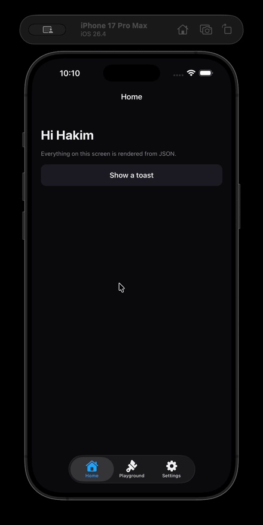

# Hi, I'm Hakim

**Fullstack Engineer** · Building scalable backend services and cloud-native apps.

Based in Egypt 🇪🇬

---

## Stack

`React Native` `Node.js` `TypeScript` `MongoDB` `Redis` `AWS` `Docker` `Nginx`

---

## Featured

<table>
<tr>
<td valign="middle">

**[Nutix](https://www.nutix-app.com/en)** — AI-powered nutrition and calorie tracker. Solo project, end-to-end: mobile app, backend, infrastructure. Closed source, live in production.

</td>
<td width="180" align="center" valign="middle">
  
</td>
</tr>

<tr>
<td valign="middle">

**[react-native-sdui](https://github.com/HakimMohamed/react-native-sdui)** — a server-driven UI experiment for React Native. The backend renders screens from Mustache templates as JSON; the app is a thin renderer over a fixed component catalog, so new screens ship without a rebuild. Expo SDK 55 · Mustache · Zod · Express · TypeScript.

</td>
<td width="180" align="center" valign="middle">
  
</td>
</tr>
</table>

---

## Experience

- **[Battal](https://battalapp.com/)** — Smoking cessation app *(Architect & Lead Developer)*
- **[Botit](https://www.botitapp.com)** — On-demand delivery platform *(Software Engineer → Mid-Senior)*

---

## Connect

[LinkedIn](https://www.linkedin.com/in/hakim-mohamed-22151b221/) · [Email](mailto:iabdelhakimmohamed@gmail.com)
