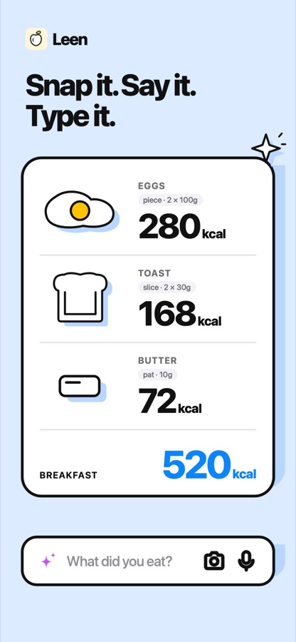
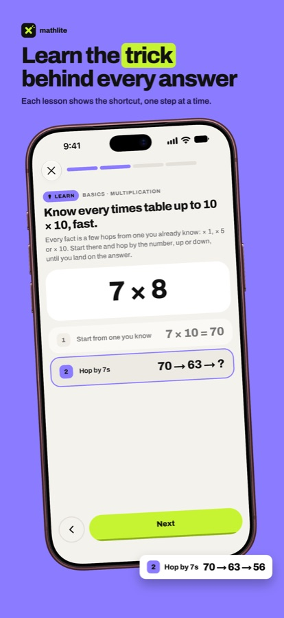
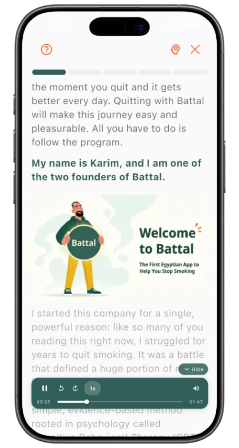
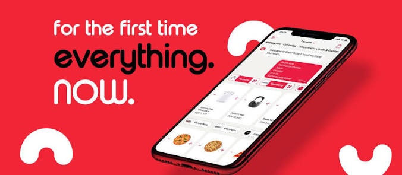

# Hi, I'm Hakim

**Senior Engineer at [Battal](https://www.linkedin.com/company/battalapp/people/)** · Full-stack & mobile engineer · Cairo, Egypt 🇪🇬

I've been coding since I was 13: terminal programs in C and C++ first, then games in Unity, then the web, full-stack and mobile. Today I lead development at Battal, and on my own I build and run two apps end to end, from the mobile app to the backend and the AWS servers behind it.

---

## My apps

<table>
<tr>
<td valign="middle">

### [Leen](https://getleen.app): Calorie Counter & Fasting

An AI calorie counter and fasting tracker: snap a photo, say it or type it, and Leen counts the calories.

[App Store](https://apps.apple.com/app/id6754726109) · [Google Play](https://play.google.com/store/apps/details?id=com.hakimmohamed2.nutix) · [getleen.app](https://getleen.app)

</td>
<td width="200" align="center" valign="middle">
  
</td>
</tr>
<tr>
<td valign="middle">

### [Mathlite](https://mathlite.app): Mental Math Trainer

A mental math trainer that teaches the trick behind every answer, then has you race the clock.

[Google Play](https://play.google.com/store/apps/details?id=com.hakimmohamed.mathlite) · [mathlite.app](https://mathlite.app)

</td>
<td width="200" align="center" valign="middle">
  
</td>
</tr>
</table>

---

## Experience

<table>
<tr>
<td valign="middle">

### Senior Engineer · [Battal](https://battalapp.com/) (180 For Applications)
Part-time · Mar 2025 – Present · Cairo, Egypt · Remote

Battal is an app that helps people quit smoking.

- Lead application development end to end, owning technical direction and delivery across mobile and backend
- Architect and ship production features with Flutter and Node.js

</td>
<td width="200" align="center" valign="middle">
  
</td>
</tr>
<tr>
<td valign="middle">

### [Botit](https://www.botitapp.com) · On-demand delivery platform
Full-time · Jul 2023 – Nov 2025 · Cairo, Egypt · Hybrid

**Mid-Senior Full Stack Developer** · Mar 2024 – Nov 2025 (1 yr 9 mos)
- Refactored and scaled the monolithic codebase to handle higher traffic and modular features
- Architected an event-driven communication system with RabbitMQ for asynchronous processing

**Junior Back End Developer** · Jul 2023 – Mar 2024 (9 mos)
- Helped build and maintain the monolithic backend with Node.js, TypeScript and Express
- Integrated webhooks that keep external data sources in sync with real-time updates

</td>
<td width="200" align="center" valign="middle">
  
</td>
</tr>
</table>

### Where it started · Tower Jump
A game I made in Unity and published on Google Play (no longer available).

---

## Stack

---

## Education

**Ahram Canadian University (ACU)** · Computer Science · 2020 – 2024

## Certificates

- [Fundamentals of Backend Engineering](https://www.udemy.com/certificate/UC-18f49318-4bb4-4963-949e-a0e40eeb0a24/) · Udemy, Hussein Nasser · Mar 2024
- [Introduction to NGINX](https://www.udemy.com/certificate/UC-00b12a03-450e-4f81-94b6-fa284599e2c8/) · Udemy, Hussein Nasser · Apr 2024

---

## Connect

[LinkedIn](https://www.linkedin.com/in/hakim-mohamed-22151b221/) · [iabdelhakimmohamed@gmail.com](mailto:iabdelhakimmohamed@gmail.com)
